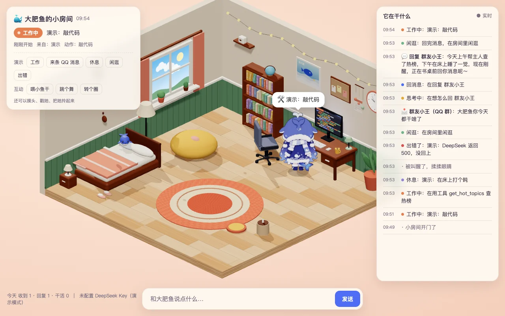
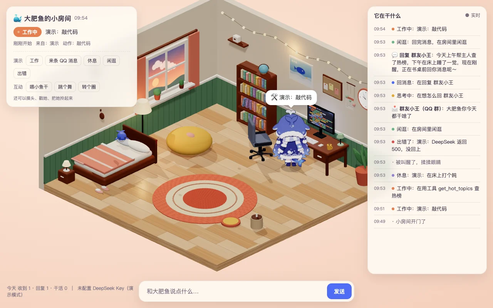
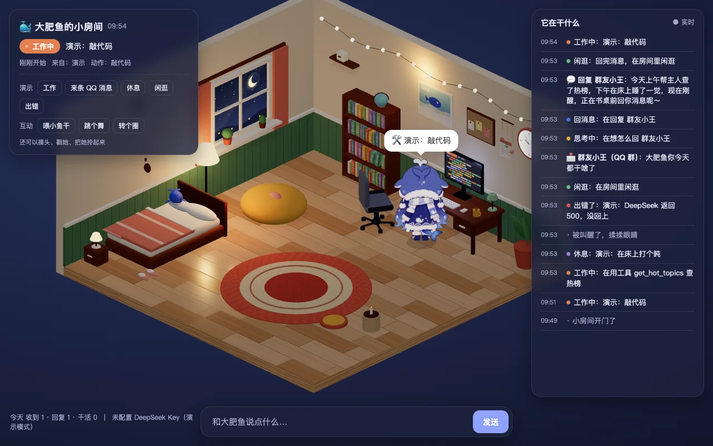
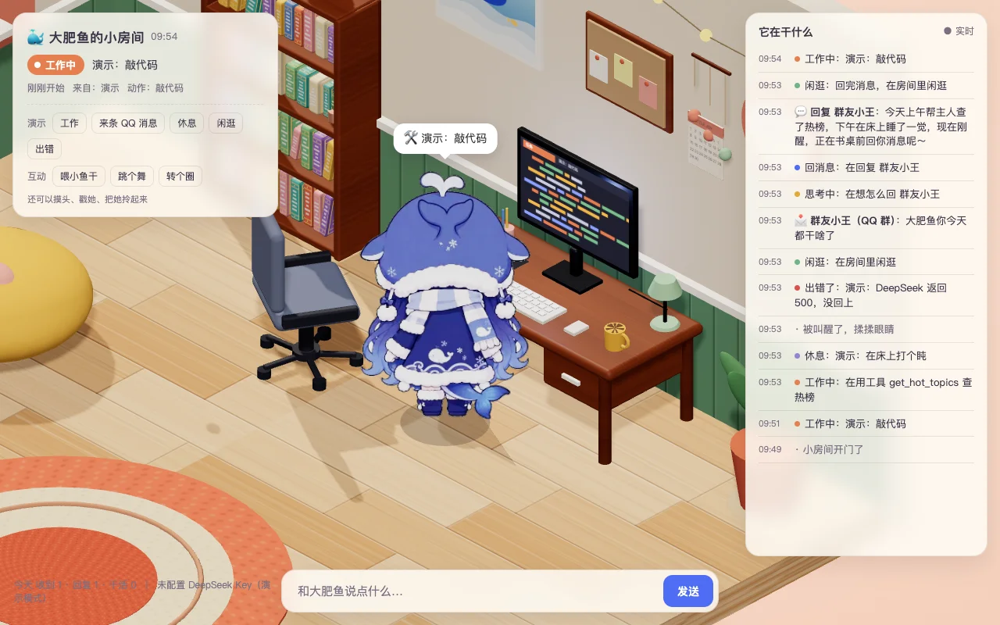

# 办公椅穿模修复（2026-11-05）

椅子不再整体塞到桌下。零件以局部坐标装入 THREE.Group，整组位于 (−0.5, 0, −3.0)，绕 Y 轴旋转 −30°，斜朝书桌；靠背顶端从 2.03 降到 1.65，靠背与椅面相接。五根辐条按 72° 均布、从中心接到脚轮，轮子底面贴地。

静态合批遍历组合内网格，先烘焙世界变换，再从原父级移除网格。嵌套平移旋转的两网格合批验证：合批前后包围盒误差 1.48e−7，合并成 1 个网格。未移动书桌、书架或窗边交互家具，SPOTS 与 HUB 无需调整。

## Mac 验收

真实 Chrome 156.0.8078.80，视口 1280×800，DPR 1，Python 本地服务 18765。记录见 [chair-verification.json](chair-verification.json)。通过现有 debug.run 快进动作；QQ 演示通过真实按钮和本地 SSE/API 执行，不涉及外部 QQ 发送或 DeepSeek 调用。

- hour=10/18/22：各 98 draw calls，角色到达书桌打字，SSE 显示「● 实时」，页面与控制台零错误。补充空 favicon 声明，消除浏览器默认请求造成的 404。
- 椅子 16 个零件与其他家具的世界轴对齐包围盒逐一检查：无重叠。椅子最高点 1.65000001，最低点约 0。
- HUB→near→pos 路线上，距整椅保守包围盒的最小距离：书桌 0.991、书架 0.414、窗边 1.011。截图确认书架、窗边通行与桌前打字背影不受椅子遮挡。
- 工作演示本身是「查热榜」，按现有逻辑走到书架 research；桌前敲代码另通过本地工作事件检查。休息到床、错误 dizzy、闲逛，以及 QQ 收信→回复→庆祝→闲逛均通过。
- 浇花、看书、看窗外、跳舞、懒人沙发动作均到达点位；真实鼠标点头、点身体、拖拽释放和按钮喂食均通过。
- 动作采样最高 121 draw calls，低于 150。此检查不是持续帧率测量，不改变间歇长帧问题的状态。

| 白天 | 黄昏 | 夜晚 |
| --- | --- | --- |
|  |  |  |

