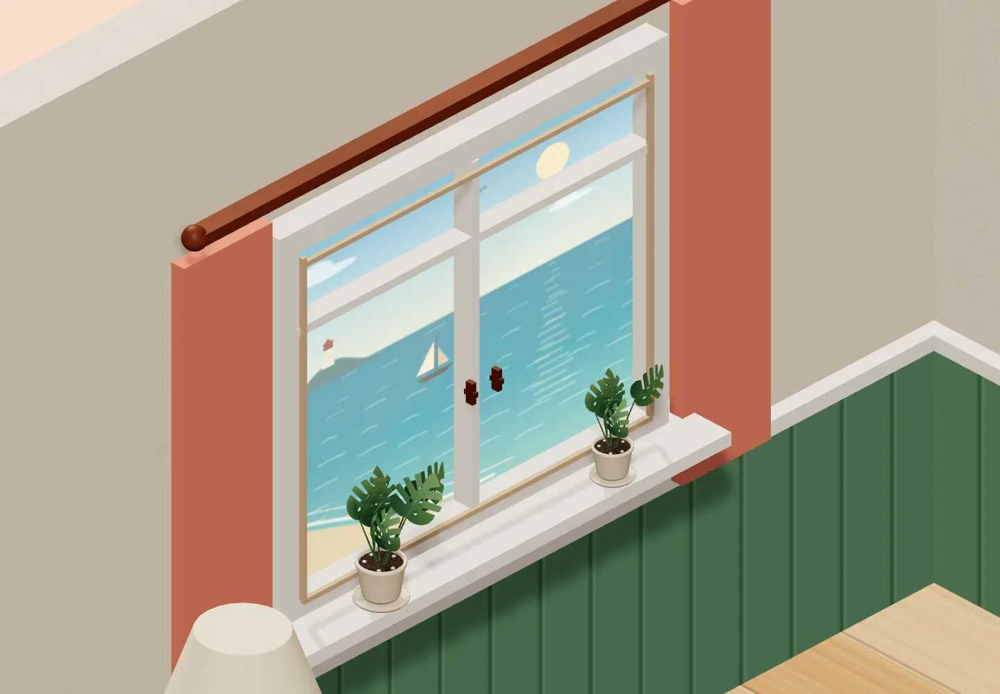
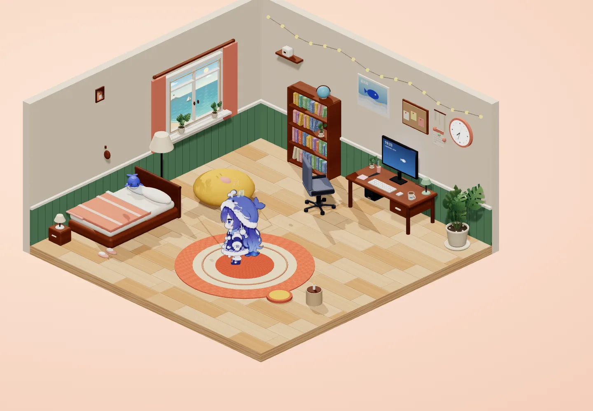
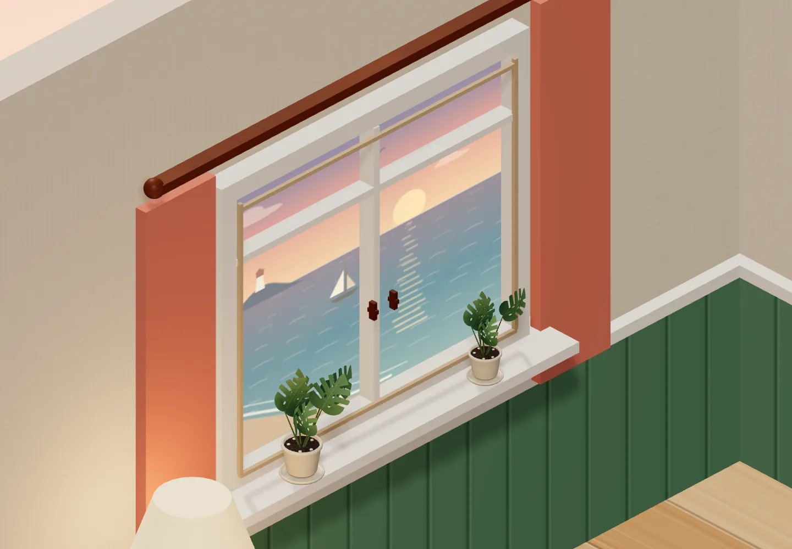
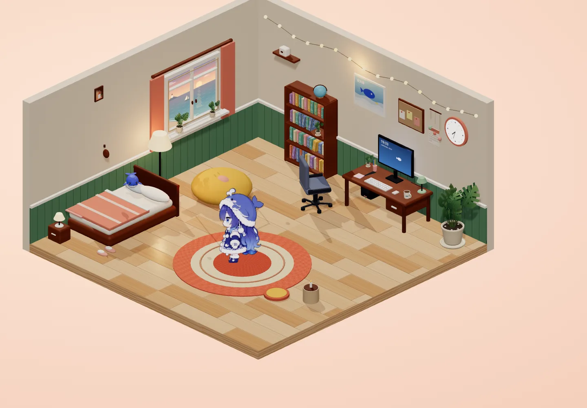
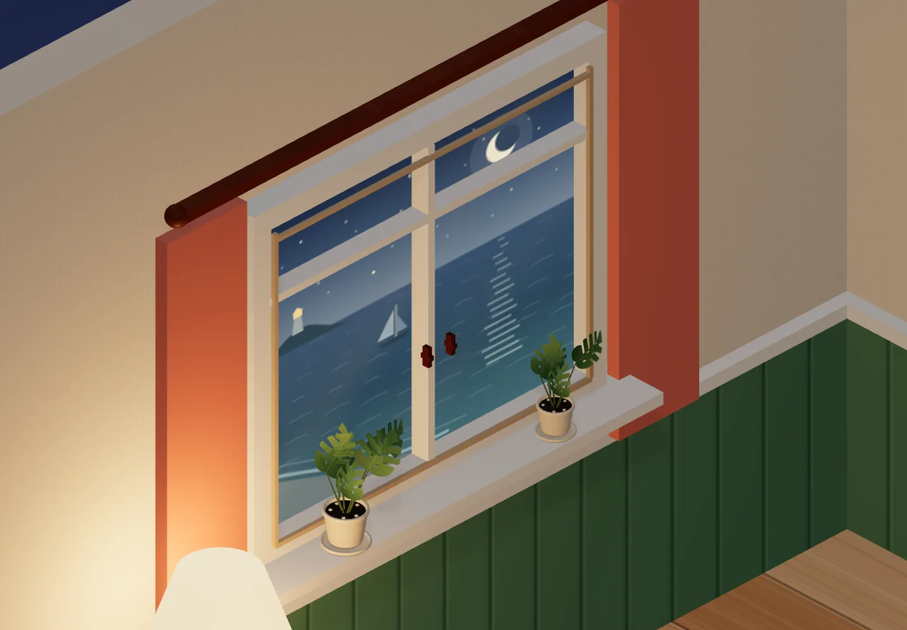
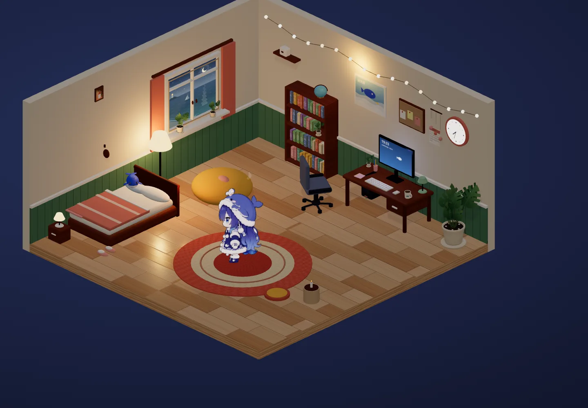

# 海景窗户与窗台盆栽

2026-11-05，在 feat/plant 上接续鲸鱼马克杯修改。

## 改动

- 窗台两盆改为奶油釉面陶盆、带盆沿和底碟、颗粒土、小石子与手绘龟背竹叶。尺寸为主盆的 0.32 和 0.26，六片与五片叶子，高低错落。
- 在 index.html 创建共享植物组件，房间和家具共同使用。五盆共 30 片叶子，共用两组动态实例及两组静态材质批次，不重复创建贴图。实例容量 32，实际 count 随建模更新，超过容量明确报错；每片相位独立。
- 保留奶油窗框、珊瑚色窗帘和玻璃，加入浅木内衬及小木把手。中横杆移到上方成为亮窗，避免挡住海平线。
- src/seascape.js 用 256² Canvas 绘制海景：渐变天空、海水、远岛灯塔、帆船、海鸥、碎光、沙滩和白浪。白天蓝绿海面，黄昏落日与暖色倒影，夜晚星月与灯塔灯光。
- 沿用原有每分钟刷新与 hour 参数；海浪是静态手绘笔触，未增加逐帧纹理上传。全部素材程序化生成，无下载、无新增构建步骤。
- 窗户、角色 SPOTS.window、near 点、HUB 路线保持原位；盆栽位于窗台两侧，眺望位置正常。

## 验证

真实 Chromium，1440×1000。结构化结果见 [ocean-verification.json](ocean-verification.json)。

| 项目 | 实测 |
| --- | --- |
| hour=10 / 18 / 22 全景 draw calls | 94 / 91 / 93 |
| 演示与互动采样峰值 | 114，低于 150 |
| 材质与三张预加载立绘纹理估算 | 14.96MiB，含 mipmap，不含阴影目标与浏览器画布 |
| 叶片总数 | 30 |
| 控制台错误 | 0 |
| SSE | 实时 |

完成书桌工作、书架查资料和阅读、床上休息、出错、QQ 演示收信回复与喷水、地毯跳舞、懒人沙发、窗边眺望、浇花、摸头、戳身体、拖拽与喂食回归。所有显式站点动作确认到达；浇花后主盆恢复原始缩放，所有叶片记录到微风摆动。

六张三时段图片与回归截图均为 WebP，单张小于 300KB。美术截图在测试浏览器临时隐藏 HUD，不修改产品界面。绘制次数含随机家具和临时粒子差异，不作为 FPS 测试。

| 时段 | 近景 | 全景 |
| --- | --- | --- |
| 白天 |  |  |
| 黄昏 |  |  |
| 夜晚 |  |  |

提交前检查 git diff --check 与 git status，config.json 和 room/ 不在提交范围。
