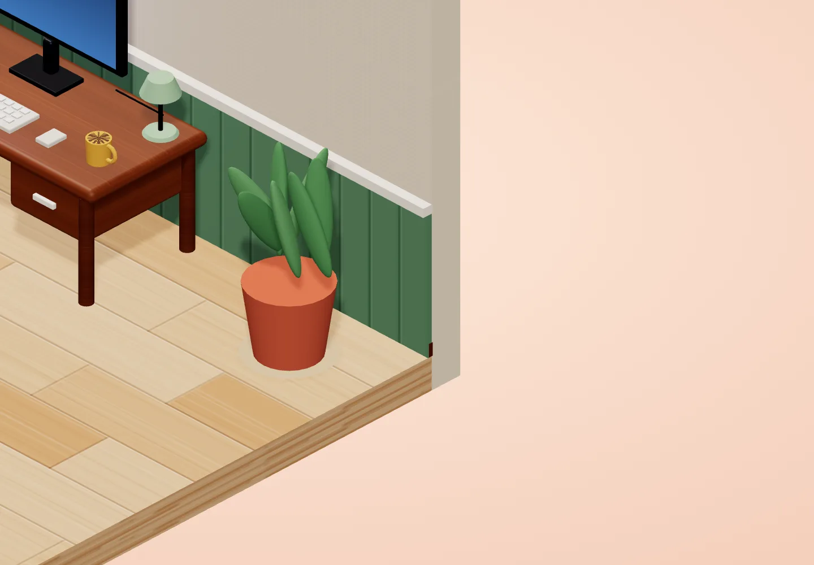
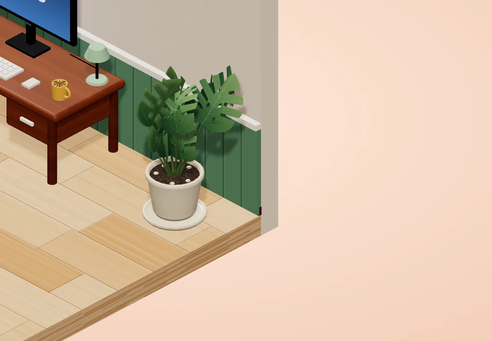
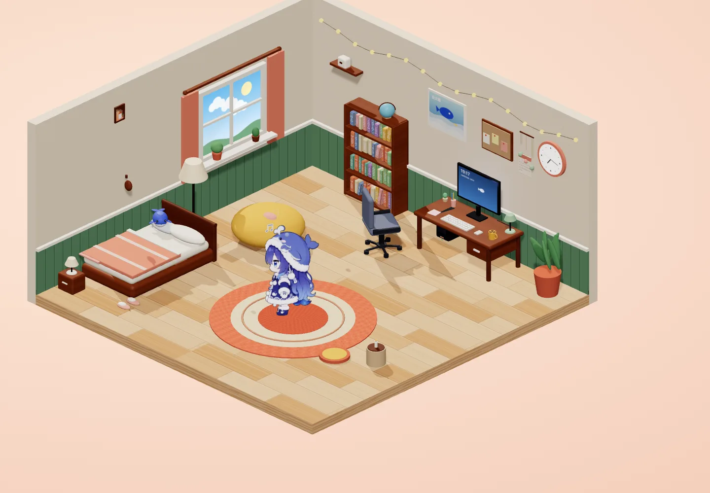
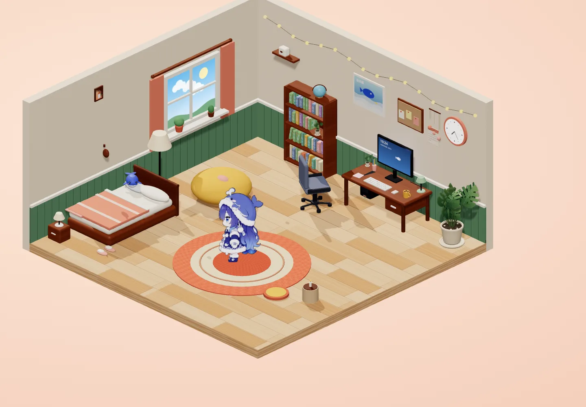
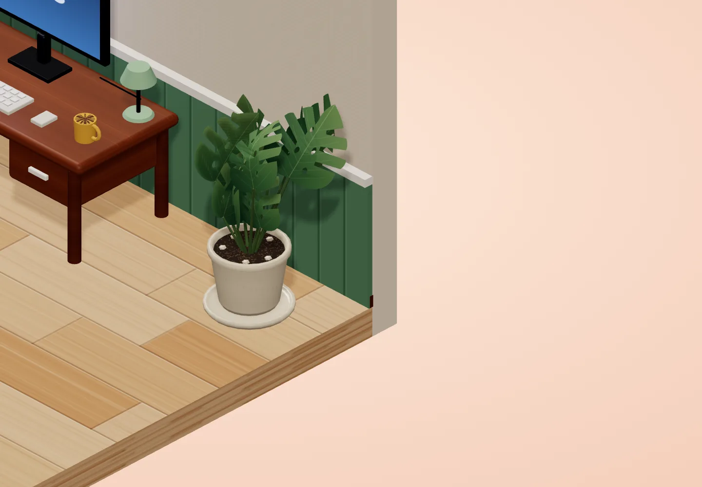
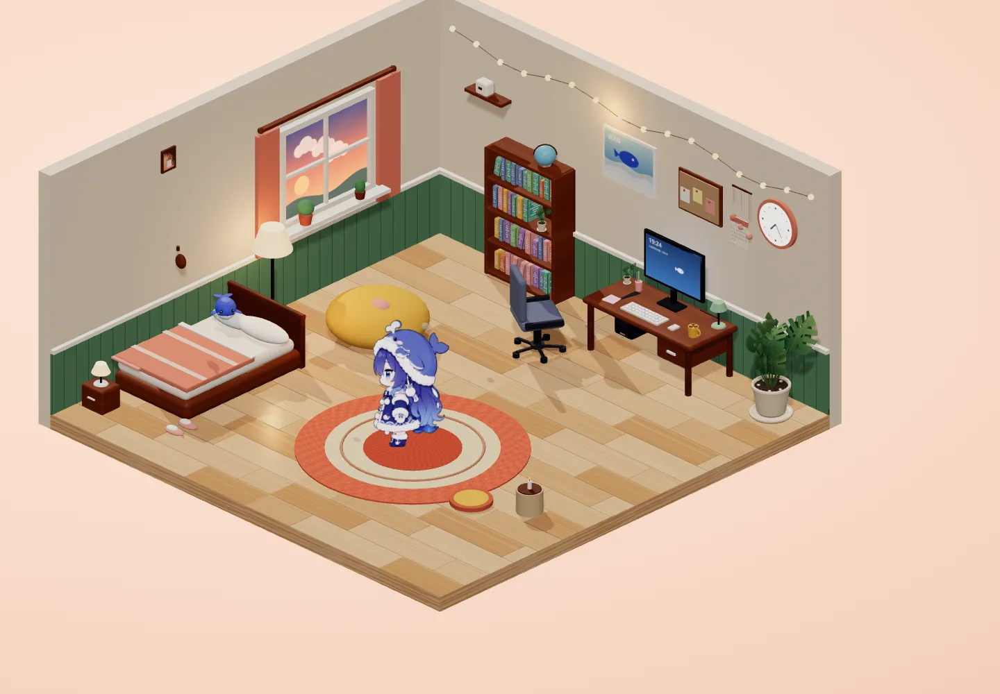
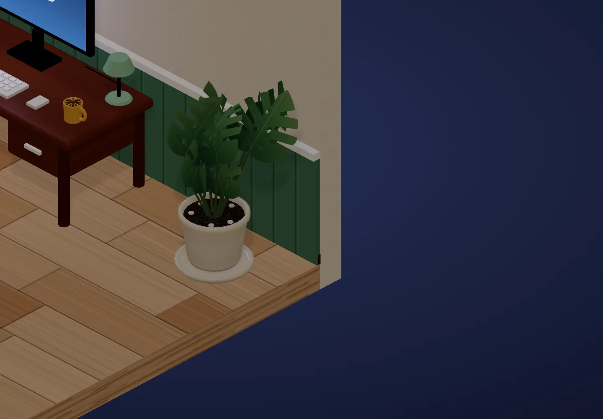
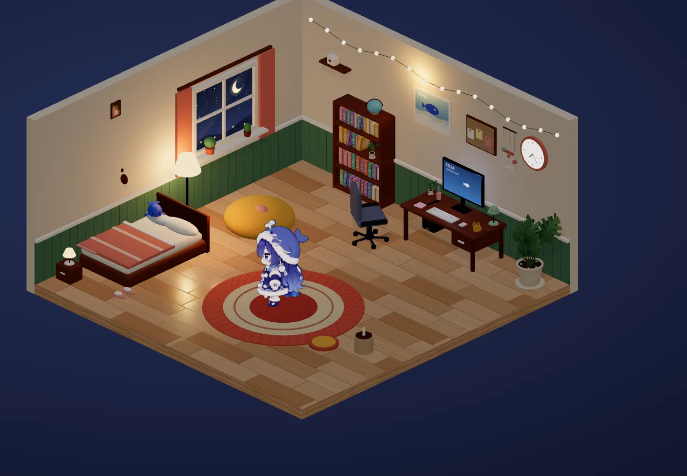
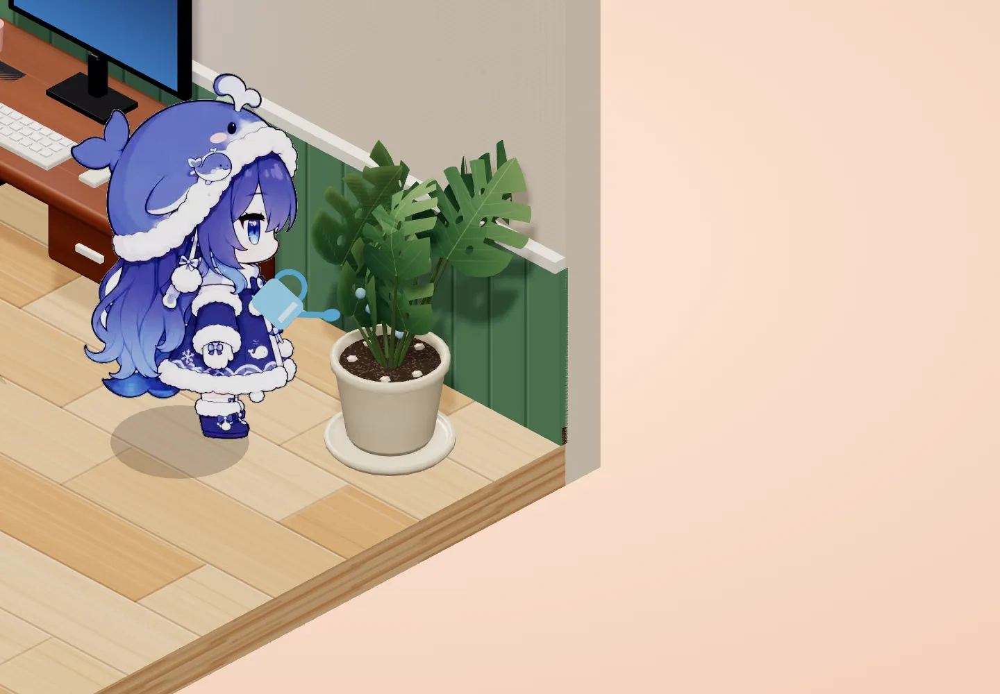
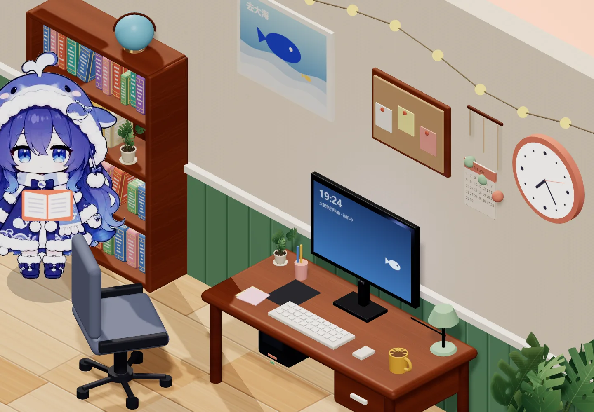

# 盆栽精修：手绘龟背竹

2026-11-05。在主工作目录先 `git pull`，基于已含椅子修复的 `196f39c` 开始，提交到 `feat/plant`，待看图后合并 main。

## 选择与造型

选择龟背竹：裂叶和孔洞在小房间全景中仍有辨识度，深浅绿的叶面与雾绿墙裙相呼应。奶油色陶瓷盆配暖色颗粒土，保持温馨日系、低多边形和柔和手绘感，不使用外部素材。

新增 `src/plants.js`，由 `src/furniture.js` 调用。主盆九片叶；书架和桌面各五片，整体比例分别为主盆的 0.23 和 0.19。两盆小植物也改成龟背竹幼株。桌面盆保持原位置；书架第三层右侧少放几本书，为小盆栽留空，盆中心移至 (-1.92, 1.37, -4.53)，避免书本和侧板遮挡，书架与角色阅读站位不变。

- `ShapeGeometry` 构造非对称心形叶，叶缘有四对裂口，内部有四个真正的几何孔洞。顶点按主脉方向弯曲、叶缘略折，叶片双面显示。
- 512² Canvas 绘制绿叶渐变、主脉、支脉和轻微笔触；每片叶子的大小、朝向和叶柄终点不同，高低错落。
- 细六边柱叶柄从土里连接到叶基，随叶基位置同步更新。
- `LatheGeometry` 旋出有内壁、厚盆沿的陶瓷盆和底碟。釉面 roughness 0.28、metalness 0.03，256² 纹理加入窑烧色差和细点。
- 土面使用独立的 256² 深色颗粒纹理，加五颗低多边形小石子。

## 动画与耦合

保留 `plantLeaves` 接口；其元素是驱动实例矩阵的 `Object3D`。每片叶子的 `userData` 保存 `basePosition`、`baseRotation`、`baseScale`、相位和实例同步函数。逐帧先恢复原变换，再叠加约 1–1.4° 的微风摆动；不存在原先写死的 `0.85`。

浇花结束阶段只触发一次整体阻尼回弹。主盆叶片使用同一回弹包络，小盆不跟着弹；衰减到零后缩放精确恢复，微风继续。实测倍率序列和恢复结果保存在 [plant-verification.json](plant-verification.json)。

盆中心仍为 `(4.25, 0, -4.25)`；`SPOTS.plant` 仍为 `(3.35, 0, -3.35)`，原来的 HUB、near 点和路线无需修改。壶嘴约在 `(4.10, 1.10, -4.07)`，按原速度范围 0.3–0.7 计算，水滴到达 y=0.585 土面时均在半径 0.315 内。水滴寿命改为落至土面的时间，避免继续穿盆。浇花近景确认角色与叶片之间有空隙。

## 性能

三盆共享一个叶片 `InstancedMesh`（19 实例）和一个叶柄 `InstancedMesh`。盆、底碟、石子按陶瓷材质合并，土面按土材质合并，三盆合计 **4 个主渲染绘制批次**。实例网格由现有 `batchStaticRoom` 自动跳过，不会误合并动态叶片；静态合批逻辑未修改。

浏览器：真实 Chromium，WebGL 2.0，1440×1000。通过 `__room.run()` 固定动画时刻采样，非 FPS 基准测试。

| 项目 | 结果 |
| --- | --- |
| 改动前 `196f39c` 白天全景采样 | 101 draw calls |
| 改动后 hour=10 / 18 / 22 全景 | 93 / 93 / 93 |
| 演示与互动采样峰值 | 116，低于 150 |
| 新增纹理 | 512² 一张、256² 两张，含 mipmap 约 2MiB |
| 场景材质 + 三张预加载立绘 | 回归结束时约 14.73MiB，低于 16MiB |

绘制次数受随机家具、粒子和当前动作影响，基线与新版本是同视口的独立采样；不将差值解释为精确 FPS 收益。纹理按 RGBA8 和完整 mipmap 估算，阴影目标、浏览器画布和驱动开销另计。

## 验收

所有截图为 WebP、1440×1000，单张小于 300KB。三时段与前后对比图仅在测试浏览器临时隐藏 HUD，避免遮挡右侧植物；产品界面未改。动作回归图保留 HUD，`water-ui.webp` 可见“实时”和浇花状态。

- 三时段全景与近景均检查完成。
- 控制台错误 0，SSE 显示“● 实时”。
- 演示“工作”本身带“查热榜”，按现有规则进入书架 research；另用本机演示事件验证书桌敲代码。
- QQ 演示覆盖收信、从地毯跑向书桌、回复和庆祝喷水。仅使用内置演示，不向真实 QQ 发消息。
- 床上休息、出错晕眩、书架阅读、地毯跳舞、懒人沙发和窗边眺望均检查；显式动作在到达对应站点后触发。
- 鼠标真实点击头和身体，分别触发 pet、poke；拖拽 held=true，释放后落地；喂食触发 eat，小鱼干消失。
- `__room.act('water')` 检查水流落点，记录弹跳伸展、压缩和回位；19 片叶子均记录到微风角度变化。
- `git diff --check` 无问题。推送前确认 `config.json`、`room/` 被忽略且不在提交文件中。

复查入口：`http://127.0.0.1:18765/?debug&hour=10`。控制台先 `__room.goTo('plant')`，等角色到达后 `__room.act('water')`；近景可用 `__room.look(3.9, 1, -4, 3)`。完整结构化记录见 [plant-verification.json](plant-verification.json)。

## 改动前后

| 改动前 | 改动后 |
| --- | --- |
|  |  |
|  |  |

| 时段 | 近景 | 全景 |
| --- | --- | --- |
| 10 点 |  |  |
| 18 点 |  |  |
| 22 点 |  |  |

| 浇水 | 回弹 | 恢复 |
| --- | --- | --- |
|  |  |  |

### 两盆小植物

