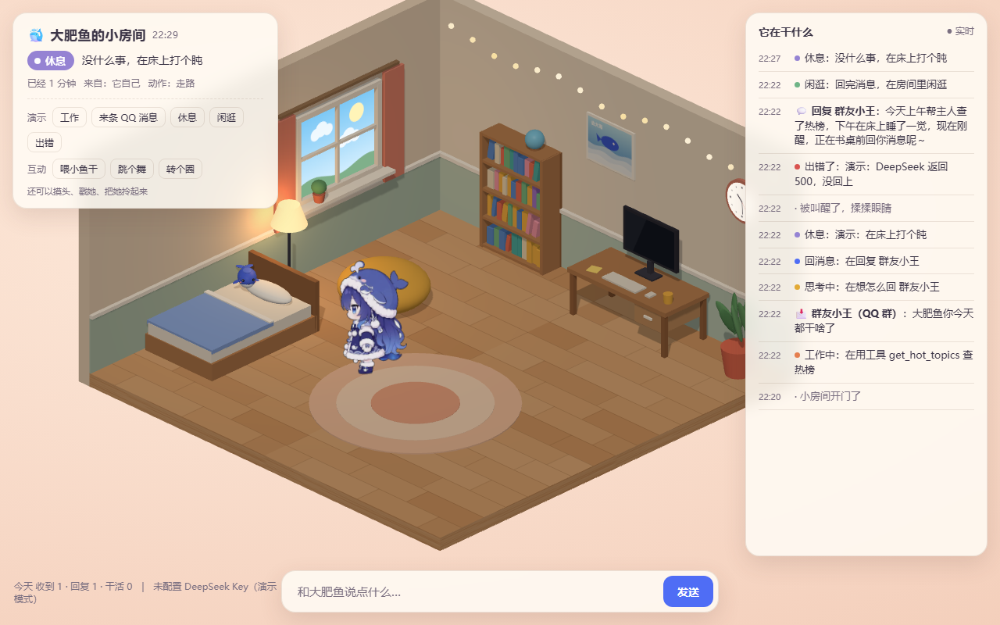
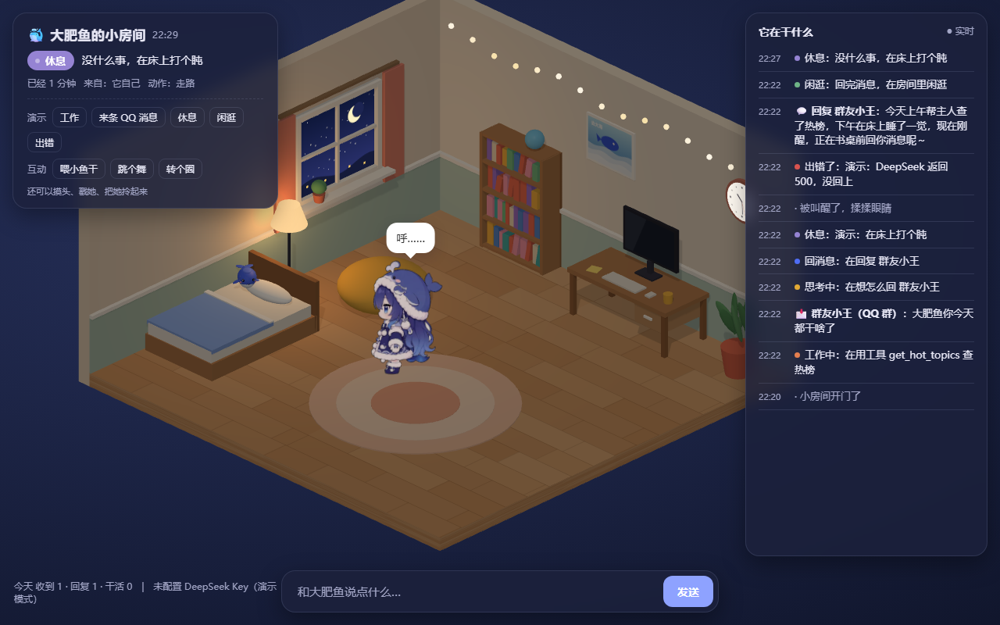
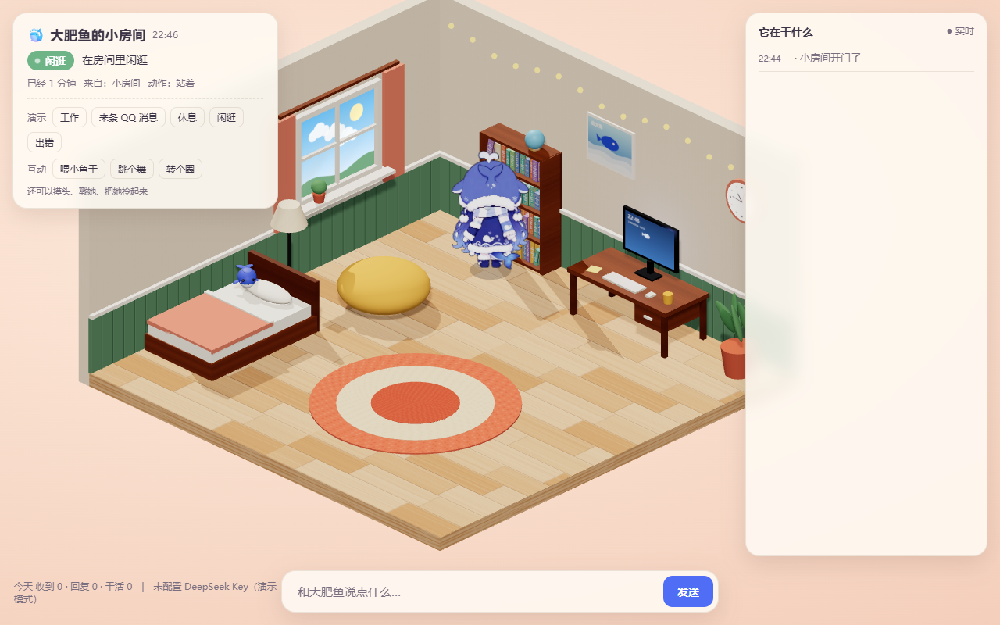
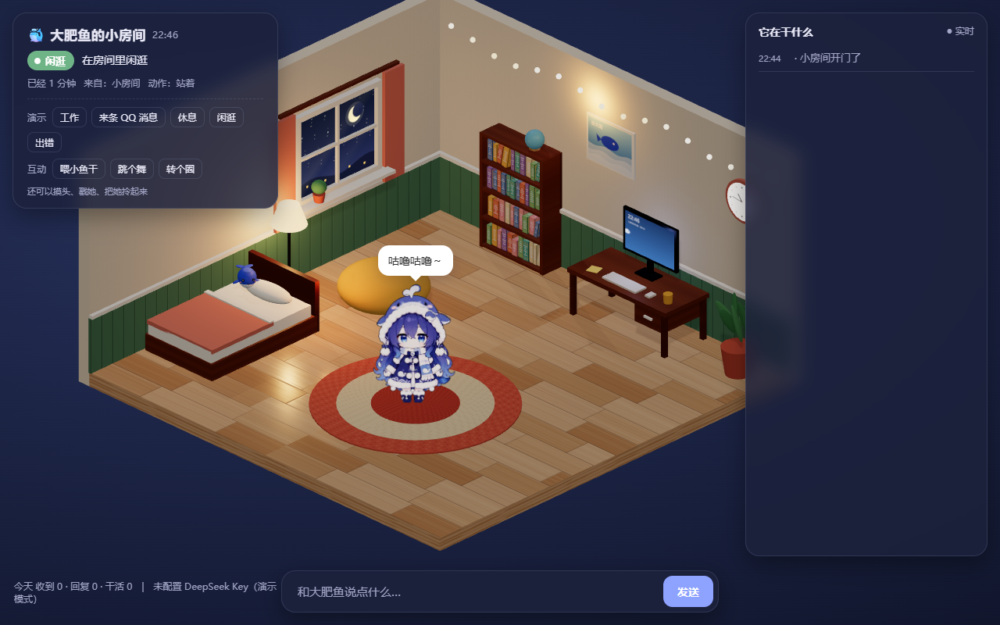
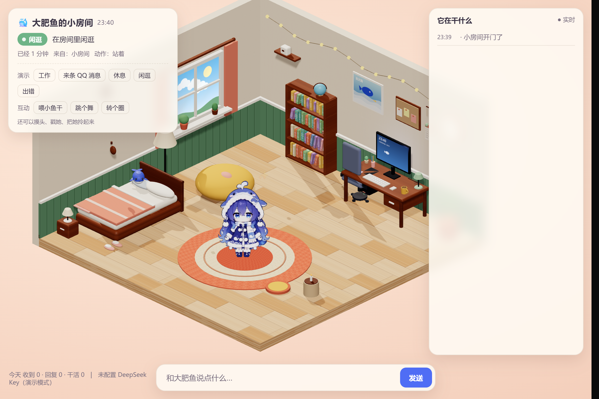
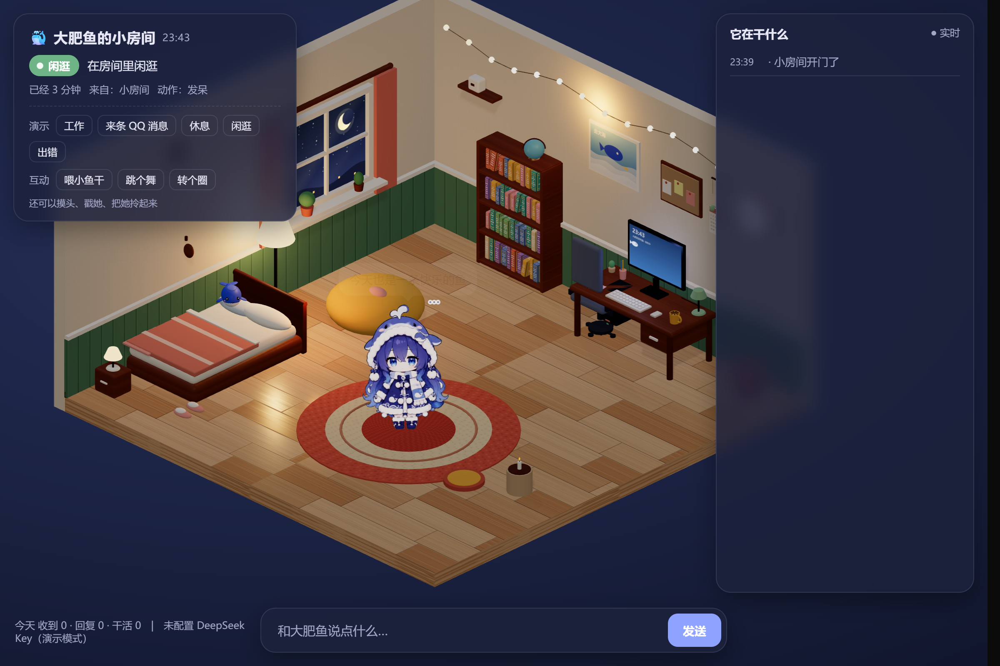
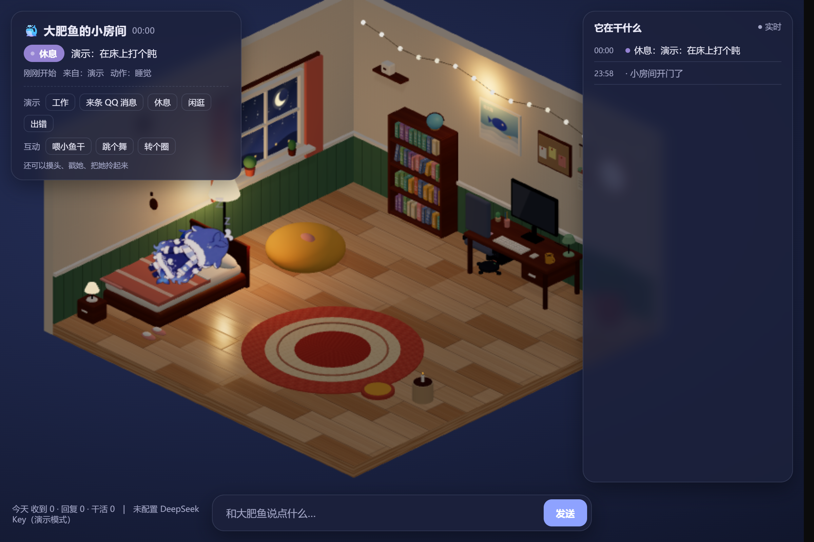

# 大肥鱼的小房间 v2

当前状态：模块拆分已合并 main；家具和材质已依次合入 `integration/room-v2`，尚未合并 main。动作、Draw call、加载和材质纹理预算通过；OpenBot 浏览器内连续帧率未达到 60 FPS，性能验收仍未通过。

## 设计

温馨日系小屋，以精致低多边形几何和程序化手绘纹理配合角色立绘。墙面、床品与地板保持较高明度，让深蓝白色角色成为视觉中心。暖木色用于地板与家具，奶油白用于墙纸和窗框，雾绿用于墙裙，珊瑚粉用于床品与窗帘；蓝色留给角色及少量装饰。

| 用途 | 色彩方向 |
| --- | --- |
| 地板 | 暖橡木、不同木板的浅深变化 |
| 墙纸与框线 | 奶油白 |
| 墙裙 | 雾绿 |
| 床品与窗帘 | 珊瑚粉、奶油白 |
| 夜间照明 | 暖琥珀色 |

## 模块接口与负责人

| 文件 | 接口 | 负责人 |
| --- | --- | --- |
| `src/materials.js` | `createMaterials(scene, rand, pick)` 返回绘制工具、程序化贴图与材质 | 材质灯光师 |
| `src/room.js` | `createRoom(scene, tools)` 返回天空纹理与真实时钟更新函数 | 家具布局师 |
| `src/furniture.js` | `createFurniture(scene, tools)` 返回屏幕、灯具、植物及串灯引用 | 家具布局师 |
| `src/lighting.js` | `createLighting(scene, sky, getRoom, rand)` 返回昼夜函数、灯光目标及插值状态 | 材质灯光师 |
| `index.html` | 角色、动作、粒子、HUD、服务连接及模块集成 | 主管 |
| `src/geometry.js` | 静态几何合并及自适应绘制分辨率 | 主管 |

`tools` 包含原有 `mat/box/cyl/blob/canvasTexture/floorTex/rand/pick`，并支持可选的 `materials/floorMaterial`。`getRoom()` 在运行时提供状态，避免初始化时读取尚未创建的状态对象。灯光返回的 `light` 与 `lightTargets()` 使用相同键，由现有逐帧指数插值完成平滑过渡。

## 材质与光照

所有新增纹理由 Canvas 程序化绘制，不依赖外部贴图或模型。地板包含木板颜色、接缝、木纹、粗糙度和轻微法线；数据贴图使用 `NoColorSpace`。墙纸使用纸纤维暗纹，墙裙带板条凹槽，家具使用暖木纹，地毯使用编织纹，床被使用织物纹理，书脊使用装饰条纹。玻璃以透明高光面表现反光。

ACES 色调映射配合环境光、日光、窗向投影光与夜间暖色点光源。`?hour=10`、`?hour=18`、`?hour=22` 分别用于白天、黄昏、夜晚检查，仅覆盖视觉昼夜时间；墙上时钟继续显示真实时间。

## 基线与验证

模块拆分后的基线记录见 [baseline-test-records.json](baseline-test-records.json)。基线四种演示状态（工作、收消息、休息、错误）在恢复屏幕换行函数后均无 JavaScript 报错。

| 基线 `d618b72` | 白天 | 夜晚 |
| --- | --- | --- |
| Draw calls（单次采样） | 145 | 143 |
| 三角形数 | 28214 | 28190 |

这些采样不构成帧率测试。最终版本还需测量前台持续帧率、首次加载到角色就绪时间、全部预加载角色纹理及 mipmap 占用，并单列阴影渲染目标开销。

### 改动前：白天



### 改动前：夜晚



集成验收需要覆盖桌前打字、床上睡觉、浇花、书架阅读、懒人沙发坐姿、看窗外、地毯跳舞七个动作，并检查 HUB 到各 near 点的路线。

## 材质分支阶段结果（非最终集成）

视觉测试对 `26ca271` 的报告见 [materials-test-records.json](materials-test-records.json)。测试运行真实 Python 服务，SSE 显示实时连接；Intel Arc 130T、ANGLE D3D11、1280×800、DPR 1。5.215 秒采样报告平均 60.01 FPS、1% low 59.52 FPS；导航到当前立牌纹理就绪为 1444ms。加载结果未证明冷缓存 CDN 请求在所有网络环境均可于 3 秒内完成。

| 材质分支 | 白天 | 黄昏 | 夜晚 |
| --- | --- | --- | --- |
| Draw calls（采样值） | 149 | 147 | 148 |

纹理报告约 8.74MiB 材质 + 1.32MiB 当前角色纹理，阴影渲染目标另计约 8MiB；这不是全部预加载角色视图的最终显存审计。家具集成后必须重新测量。





## 集成结果与对比

家具使用 Three.js 0.160 官方 `RoundedBoxGeometry`，加入床头柜与小灯、双枕头与被褶、键帽、杯柄、桌灯、软木板便签、日历、搁板、拖鞋和靠垫。办公椅收至左侧桌下避开角色打字轮廓；SPOTS 与原动作系统保持原代码。16 个串灯灯泡使用 InstancedMesh，逐实例颜色更新。静态几何按等价材质合并，植物叶片、发光灯罩和实例串灯保留动态引用。

| 时段 | 改动前 | 集成后 |
| --- | --- | --- |
| 白天 |  |  |
| 夜晚 |  |  |

构图受基线 1280×800 与集成截图 1920×1280 的截图尺寸差异影响，不应作为逐像素对照。

| 集成版 `1e0eb71`（视觉测试采样） | 白天 | 黄昏 | 夜晚 |
| --- | --- | --- | --- |
| Draw calls | 99 | 98 | 100 |
| 三角形数 | 89872 | 89268 | 89872 |

真实服务连接 SSE 正常；视觉测试报告页面加载事件 1890.6ms。该数值受本机缓存与 CDN 网络影响。材质纹理含 mipmap 约 9.04MiB，三张预加载角色立绘约 3.59MiB，合计约 12.63MiB，低于 16MiB 材质纹理预算。双 1024² 阴影渲染目标另估约 8MiB；约 20.63MiB 的合计不是整个浏览器或 GPU 总占用，未计画布、多重采样及驱动开销。

### 未通过的性能门槛

同一 Intel Arc 130T 机器上，OpenBot 浏览器原生 rAF 连续采样约 29–54 FPS，未证明达到 60 FPS。原版对照约 32–38 FPS，暂停 WebGL 绘制仍约 41–57 FPS，提示宿主合成或其他调度因素可能参与，但尚未确定根因。单次渲染提交耗时不能直接换算成实际 FPS，也不能证明持续 GPU 帧率。

`e0aae00` 增加绘制分辨率控制：最大像素比 1.5，持续超出帧预算时以 0.125 递减，最低 0.75；只影响绘制缓冲，布局与角色逻辑保持原样。主管在最低像素比下采样 240 帧约 52.27 FPS，依然未通过 60 FPS 门槛。

原始报告保存在 [integration-test-records.json](integration-test-records.json) 与 [raf-dpr-benchmark.json](raf-dpr-benchmark.json)。报告中“GPU 能力 189 FPS”“完整通过”等早期结论不予采纳，以本文门槛状态和实际 rAF 数据为准。

最新自适应版本经视觉测试等待 20 秒后，在 DPR 0.75、900×600 绘制缓冲下连续约 5 秒采样 269 帧，平均 53.61 FPS、1% low 23.98 FPS。中位帧时间 16.7ms 不代表持续 60 FPS。记录见 [adaptive-test-records.json](adaptive-test-records.json)。

通过演示“休息”触发真实服务状态，确认 `room.state=resting`、到达床位后角色横躺、缩放 0.82、Z 字符与 HUD 睡觉正常，补齐七动作验收。



## 运行

```sh
python server.py
```

访问 `http://127.0.0.1:18765/?debug&hour=10`。服务端静态路径仅接受正则白名单中的本机 `/src/*.js` 与 `/assets/*.jpg|png|webp`；API 与 AstrBot 插件保持原接口。没有新增构建步骤，也没有使用外部图片或模型素材，因此无新增素材许可清单。
